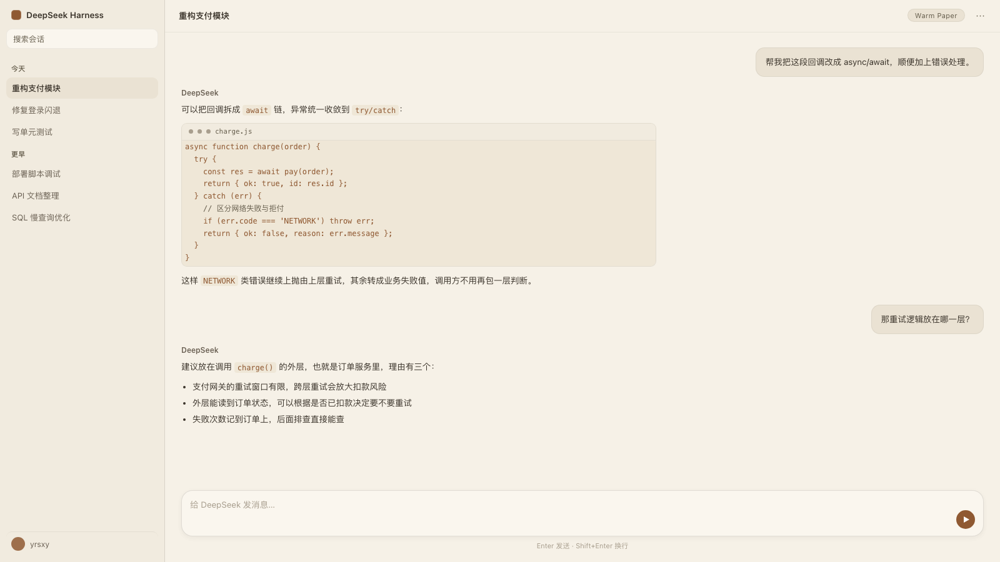
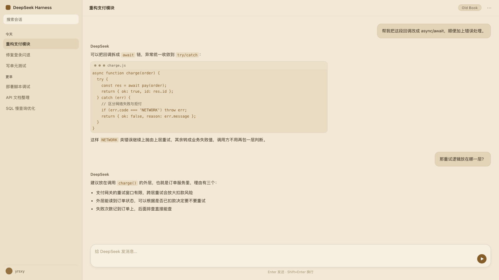
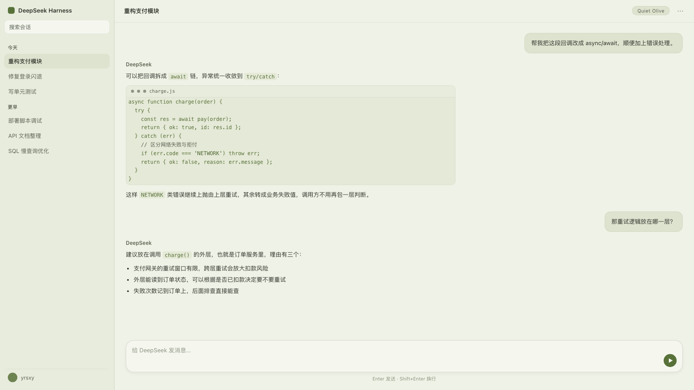
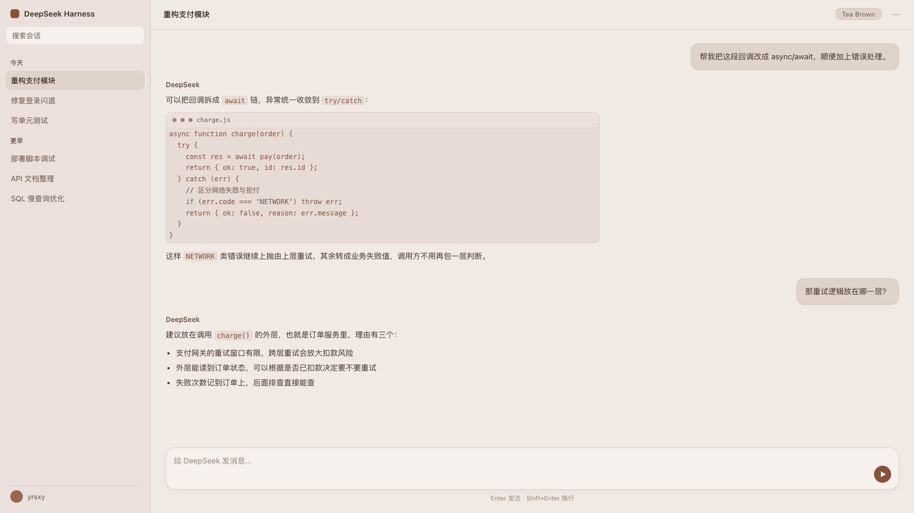
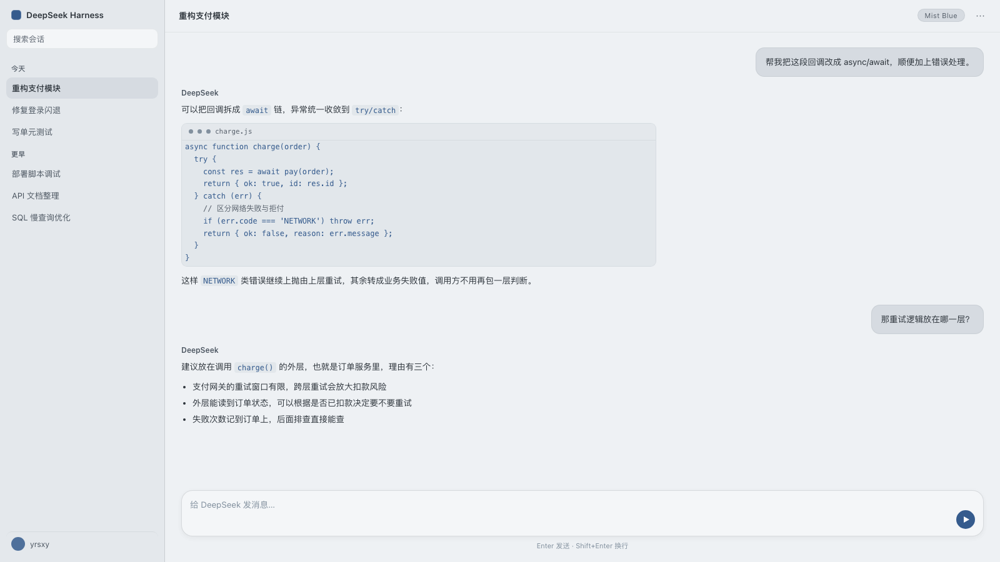
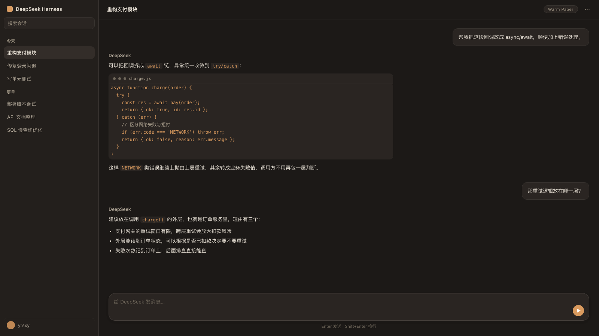
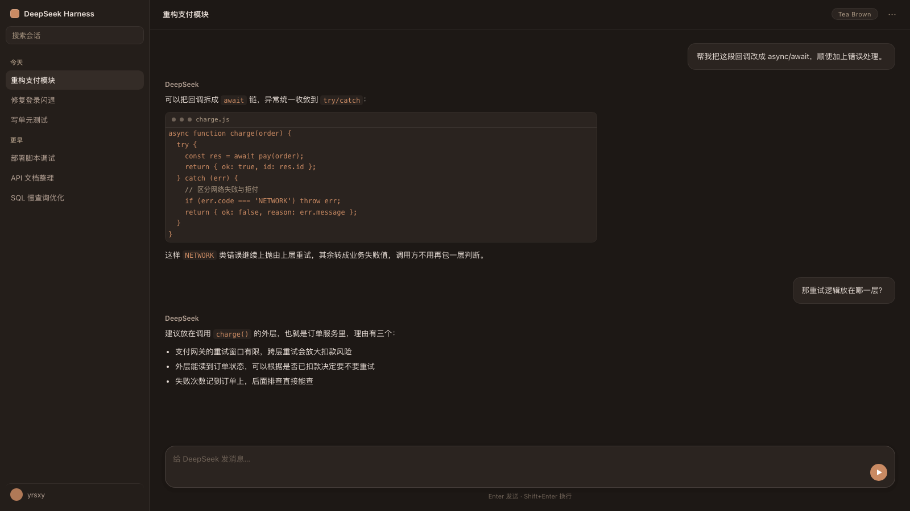

# dsh-warm-theme

[](https://www.npmjs.com/package/dsh-warm-theme)
[](LICENSE)

DSH 护眼配色包 —— 5 套低蓝光配色，通过官方 `ctx.theme.overrideTokens()` 扩展点覆盖语义 token。

**零布局改动 · 热生效 · 卸载即可还原 · macOS / Windows 双平台。**

## 预览

<table>
  <tr>
    <td align="center"><br><sub>暖纸 Warm Paper</sub></td>
    <td align="center"><br><sub>柔褐书页 Old Book</sub></td>
    <td align="center"><br><sub>橄榄静绿 Quiet Olive</sub></td>
    <td align="center"><br><sub>茶褐 Tea Brown</sub></td>
    <td align="center"><br><sub>雾蓝 Mist Blue</sub></td>
  </tr>
  <tr>
    <td align="center"><br><sub>暖纸 · 深色</sub></td>
    <td align="center"><br><sub>茶褐 · 深色</sub></td>
    <td colspan="3"></td>
  </tr>
</table>

> 预览图由配色 token 直接渲染。macOS 侧栏为系统原生毛玻璃，实际观感比图中更浅更透。

## 安装

```sh
# 从 npm（推荐，秒装）
dsh plugin --profile desktop add dsh-warm-theme

# 或直接从 GitHub
dsh plugin --profile desktop add github:yrsxy/dsh-warm-theme
```

也可以在 **插件市场** 里搜索「护眼配色」一键安装。

装好后进入 **设置 → 通用 → 配色主题**，点选即刻生效。

## 平台支持

| | macOS | Windows |
|---|---|---|
| 配色 token 覆盖 | ✓ | ✓ |
| 侧栏两段式底色 | ✓（原生同底，本包补色） | ✓（原生即两段式，无需干预） |
| 浅色 / 深色 | ✓ | ✓ |
| 实测宿主版本 | 0.2.1-rc.2 | 继承同一套 token，未单独实测 |

Windows 的正文卡片带 `--dsh-windows-content-radius`（16px 圆角），
这是 DSH 原生布局；本包只改颜色与材质，**不动圆角结构**，
所以两套平台各自保留自己的原生外观。

## 配色

| id | 名称 | 底色 | 特点 |
|---|---|---|---|
| `paper` | 暖纸 Warm Paper | `#f6f1e7` | 纸质书感，降蓝光最多 |
| `sepia` | 柔褐书页 Old Book | `#f2e8d5` | 旧书页黄，层次分明 |
| `tea` | 茶褐 Tea Brown | `#f1e9e4` | 偏红暖棕，最浓郁 |
| `olive` | 橄榄静绿 Quiet Olive | `#eff2e6` | 最低存在感，最专注 |
| `mist` | 雾蓝 Mist Blue | `#eef1f4` | 唯一冷调，最清醒 |

每套覆盖 66 个 token（浅/深各一组值），其余沿用 DSH 内置值。分四类：

**① 22 个手工调校的基础色** —— 画布、层次、文字、边框、链接、代码块。

**② 19 个派生色**（见 `lib/palettes.js` 的派生层），处理容易被忽略、
但一旦不同调就很显眼的地方：

| 派生 token | 用途 | 为什么必须派生 |
|---|---|---|
| `interactive-bg-hover` / `-active` / `-hover-accent` | 悬停、选中的叠加底色 | 内置是冷蓝灰 `#263148`，叠在暖底上会发灰（实测色相差最高 9°）；改用本套文字色做叠加源后归零 |
| `interactive-bg-hover-solid` | 不透明的悬停底 | 需与浅色第三层同调 |
| `interactive-bg-hover-danger` | 危险操作的悬停态 | 保留红调但压暗，避免在暖底上刺眼 |
| `toast-bg` / `toast-label` | 右下角通知浮层 | 内置是冷灰 `#353638`，与暖色主题割裂 |
| `tooltip-bg` / `tooltip-key-bg` | 悬停提示气泡 | 同上，内置冷灰 `#2c2c2e` |
| `specific-*`（10 个） | 侧边栏、输入框、气泡等部位专用 | 这是**独立于 `--dsw-alias-*` 的另一族**；不覆盖的话侧边栏等部位会一直用内置冷灰 |

**③ 8 个残留纯白与冷色**（Plan B）：`switch-thumb`（内置纯白，米黄底上突兀）、
`border-l4`、`menu-icon`、`menu-group-header-fill`、
`markdown-code-block-banner`、`code-segment-selected/unselected`。

**④ 17 个形状与材质**（Plan B）：

| token | 内置 | 本包 | 说明 |
|---|---|---|---|
| `radius-xs/sm/md/lg/xl/panel` | 4/8/12/16/20/28 | 5/9/14/18/22/32 | 整体上调一档，配合超椭圆更柔和 |
| `shadow-lv1/2/3`、`elevation-*` | 纯黑 `#000000` | 暖黑 | 浅色用各套文字色，深色用 `#0a0806`；纯黑叠在米黄底上会发灰 |
| `ds-transition-duration*` | .1/.2/.3s | .12/.24/.34s | 略放缓，纸感更「沉」 |
| `dsh-scrollbar-width` | 5px | 8px | 更好抓取 |

> **阴影的一个细节**：深色模式下暖黑 `#0a0806` 比纯黑亮，直接换会削弱阴影。
> 因此 alpha 乘了 1.35 做补偿，实测强度为内置的 **0.97–1.05×** —— 是「等重的暖」，
> 不是「更重的暖」。（首次实现没做补偿，实测 2.19×，明显偏重，已修正。）

### 对比度

全部 10 种组合（5 套 × 浅/深）的 5 个角色均 ≥ 4.5:1（WCAG AA），正文 ≥ 10.6:1（AAA）：

| 方案 | 模式 | 正文 | 次要 | 三级 | 强调 | 链接 |
|---|---|---|---|---|---|---|
| 暖纸 | 浅 / 深 | 11.06 / 13.47 | 5.39 / 7.54 | 5.11 / 4.87 | 5.12 / 7.27 | 4.55 / 7.27 |
| 柔褐书页 | 浅 / 深 | 11.72 / 13.37 | 6.03 / 7.37 | 5.09 / 4.69 | 4.81 / 7.15 | 4.86 / 7.15 |
| 橄榄静绿 | 浅 / 深 | 11.36 / 13.85 | 5.48 / 8.13 | 4.62 / 5.18 | 4.84 / 8.06 | 5.61 / 8.06 |
| 茶褐 | 浅 / 深 | 10.67 / 13.41 | 6.21 / 7.26 | 4.59 / 4.61 | 5.33 / 6.11 | 5.16 / 6.11 |
| 雾蓝 | 浅 / 深 | 11.28 / 13.91 | 6.59 / 8.43 | 4.86 / 5.58 | 6.11 / 7.31 | 6.11 / 7.31 |

## 使用

安装后进入 **设置 → 通用 → 配色主题**，点选即可，立即生效并跨重启保留。
选「跟随内置」即恢复 DSH 原生配色。选项旁的色块就是该套配色的实际底色与强调色。

## 卸载

```sh
dsh plugin --profile desktop remove dsh-warm-theme
```

覆盖层随插件卸载一起注销，配色立即回到 DSH 内置值 ——
没有残留文件，也没有改过任何内置资源。

## 工作原理

DSH 的主题系统把「第三方主题」设计成一个扩展点：

```
ctx.theme.overrideTokens(source, { '--dsw-alias-bg-base': { light, dark }, ... })
```

- 覆盖层是 **token 级**的，按注册顺序折入活动主题；**不修改内置主题**。
- 返回 disposer：本包在切换时会先撤销旧层再叠新层，保证任何时刻最多只贡献一层。
- 插件卸载时自动移除覆盖层，不会留下污染。

本包因此不需要重建前端、不需要 fork、也不受 DSH 升级影响。

## 开发

```sh
node build.mjs      # 把 palettes.js 与 styles.css 内联进 lib/client.js
node test/smoke.mjs # 冒烟测试：mock DSH 运行时，验证注入层与卸载行为
```

`lib/client.src.js` 是源码模板（含 `__PALETTES__` / `__CSS__` 占位符），
`lib/client.js` 是构建产物，即 DSH 实际加载的文件。

## 已知限制

- **不改变布局**：只覆盖颜色与材质 token。侧边栏位置、composer 结构等需 fork
  `dsh-web-frontend` 重建，不在本包范围内。
  （唯一例外是 macOS 侧栏底色，见下。）
- **不做完整性校验**：按官方说明，注册主题意味着覆盖同名别名变量，运行时不会
  校验一组覆盖是否完整。本包覆盖 66 个 token（22 个手调 + 19 个派生 + 8 个残留色 + 17 个形状材质）
  （含 10 个 `--dsw-specific-*`）。
- **持久化用 localStorage**：未走 Host settings API，因此不参与 DSH 的设置同步；
  无痕模式下降级为仅当前进程生效。

### macOS 侧边栏底色（唯一的非 token 例外）

ui-sidebar 的根容器本来写了 `background: var(--dsw-specific-sidebar-fill)`，
但紧接着有一条平台覆盖把它置空：

```css
[data-platform=darwin] .<hash>_root { background: 0 0 }
```

于是 macOS 上侧栏透明，透出 ui-layout 的 `._<hash>_frame`
（`background: var(--dsw-alias-bg-base)`）—— 与正文区同色。
这是 DSH 在 macOS 上的原生设计：侧栏与正文同底，靠边框分隔。
Windows 则走另一条分支（frame 用 sidebar-fill），天然两段式。

本包用一条 CSS 规则给 macOS 补上同类效果：

```css
[data-platform='darwin'] div[class*='_sidebarCol'],
div:has(> [data-window-drag]):not([data-window-drag]) {
  background: var(--dsw-specific-sidebar-fill);
}
```

为什么不能只覆盖 token：macOS 那条规则**不是纯 token**，里面混了硬编码的蓝色：

```css
color-mix(in srgb, color-mix(in srgb, var(--dsw-specific-sidebar-fill) 97%, #7a9bf0) 40%, transparent)
```

只覆盖 `--dsw-specific-sidebar-fill` 会留下一个蓝色调，必须整条 `background` 覆盖。

**两条选择器，一主一备**：

| | 锚点 | 为什么 |
|---|---|---|
| 主 | `[class*='_sidebarCol']` | CSS Modules 只给**哈希前缀**加随机值，`sidebarCol` 这个 local 名是稳定的；不依赖 DOM 层级，也不怕哈希变化 |
| 备 | `div:has(> [data-window-drag])` | 万一 ui-layout 改了类名，还能按结构反查（`data-window-drag` 是 macOS 标题栏拖拽区，仅在 macOS 渲染） |

两条都命中时取值相同，重复也无害。`.centerCol` / `.frame` 本包一概不碰 ——
那两个在 Windows 上由原生布局正确驱动，越位覆盖会破坏 Windows 的圆角卡片。

**失效行为**：若 DSH 升级后类名与属性都改名，本规则静默失效，侧栏回落到原生同色 ——
不报错、不影响任何其它样式。`test/smoke.mjs` 里有断言盯着这件事。

## 许可

MIT © 2026 yrsxy
